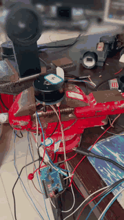

# L103 + DRV8316C Joint-Motor Driver Board (hardware, firmware, GUI + 2-stage planetary gearbox)

[中文](README.md) | English

A complete, reproducible joint-motor design: a driver board built around
**CH32L103 MCU + DRV8316C three-phase gate driver + MT6701 magnetic encoder**,
with FOC firmware, a Qt host application, and a matching **2-stage planetary gearbox (J revision, 25:1)**.



> Live demo: CH32L103 + DRV8316C board with the MT6701 encoder and the 2-stage planetary gearbox;
> the host application enables, indexes and spins over CAN. The bench supply and background
> were masked by AI.

MIT License.

---

## Repository layout

| Directory | Contents |
|---|---|
| `hardware/` | KiCad 10 project (schematic + PCB); `gerber/` holds fabrication output |
| `firmware/` | CH32L103 FOC V2 firmware — both a Makefile build and a MounRiver Studio project |
| `gearbox-J/` | 2-stage planetary gearbox, J revision (25:1): **STEP only** plus print & assembly notes |
| `docs/` | Tuning manual, low-speed FOC debugging notes, encoder magnetic-field check, hardware notes |

---

## 1. Hardware

**Design values** (source: `hardware/L103_DRV8316C.kicad_sch` netlist and `docs/硬件说明_原README.md`):

| Item | Value |
|---|---|
| MCU | `CH32L103K8U6` (QFN-32, 96 MHz) |
| 3-phase driver | `DRV8316CT` (VFQFN-40, three half-bridges / charge pump / buck), **3x PWM mode** (MODE tied to AVDD via 47 kΩ) |
| Current sensing | Three internal low-side CSAs, `SOx` → 330 Ω + 22 pF → `MOT_x_V` → `PA1/PA2/PA3` |
| CSA gain | GAIN jumper default Hi-Z = **0.3 V/A** (R49/R50 DNP) |
| OCP | `OCP/SR` to AGND via R47 = 0 Ω (threshold per DRV8316C datasheet — **not** the motor operating current) |
| Encoder | `MT6701` magnetic encoder (SSI, 14-bit), 6 mm × 2.5 mm radially magnetized magnet, 1 pole pair |
| CAN | `MAX3051EKA+T`, 1 Mbps |
| Bus voltage | 24 V nominal (firmware default `MOTOR_VBUS_DEF = 24.0 V`; measured value takes precedence when sensing is available) |
| Reference motor | `MY-4621F`, 24N22P → **11 pole pairs** (`firmware/User/board.h`) |

> Encoder air gap: the MT6701 datasheet specifies 0.5 / 1.0 / 2.0 mm (min / typical / max).
> Our build is roughly 1.5–2.0 mm by eye (not measured with a feeler gauge); the `Mg` status bit
> reads healthy over a full revolution. Details in `docs/`.

## 2. Firmware

- Three loops: current 20 kHz, velocity 1 kHz, position 200 Hz; phase currents sampled synchronously at the PWM trough.
- Velocity feedback: MT6701 over **SPI1 + DMA**, 10 kHz frame rate, PLL bandwidth default 150 Hz.
- Communications: CAN 1 Mbps (node IDs 1–63) or UART 115200 (debug console; see `firmware/docs/命令表.md`).
- Parameters: 16 tunables stored in the Flash configuration page, restored at boot; compile-time defaults are used if the page is invalid.

### Build

```bash
# Requires the WCH RISC-V GCC toolchain (bundled with MounRiver Studio)
make -B TOOLCHAIN_PATH="<MounRiver>/resources/app/resources/win32/components/WCH/Toolchain/RISC-V Embedded GCC"
```

### Flash

```bash
make flash OPENOCD='"<MounRiver>/resources/app/resources/win32/components/WCH/OpenOCD/OpenOCD/bin/openocd.exe"' \
           OPENOCD_SCRIPTS='<MounRiver>/resources/app/resources/win32/components/WCH/OpenOCD/OpenOCD/bin'
```

> **`make flash` erases the whole configuration page (0x0800FC00)** — re-run `SAVE` afterwards.

You can also open `firmware/L103_DRV8316C_FOC_V2.wvproj` in MounRiver Studio 2, press F7, and use one-click download.

### Measured (2026-10-23, 24 V bus, no load)

- Alignment: `3.20 V` applied for about 0.8 s, peak alignment current 0.85 A, ends with `aligned=1`.
- Velocity loop: 10.47 rad/s command, 8.5–11.7 rad/s measured.
- Position sequence: 18 runs × 2 segments at 700 rpm, 298–321 ms per segment, residual ±0.02 rad (≈1.1°).

## 3. Host application

The host application lives in its own repo: [`l103-servo-gui`](https://github.com/bjthemost-hub/l103-servo-gui)
(also drives the DRV8313 board). The Qt project (`L103MotorControl.pro`, builds with Qt 5 or 6): parameter tabs (RAM write / Flash save),
align / enable / velocity / move / sequence, status and waveform display, and a choice of serial or CAN transport.

## 4. Gearbox (J revision, 25:1)

A two-stage planetary reducer designed for FDM printing. Parts, print settings, assembly order,
strength and speed limits are documented in `gearbox-J/README.md` and the source documents in that directory.

## 5. Safety and limits

- This is a **development-board-level** design; no UL/CE certification. Verify bus voltage and thermal margin before power-up.
- Default current limit is 1.80 A — confirm it against your motor rating before raising it.
- The first thing to do with any new mechanism is **open loop** (no feedback): check direction, phase current, and that no phase is weak, then close the loop.
- If the motor does not turn, oscillates, or fails to follow speed, **stop immediately** — do not raise voltage to force it.

## 6. AI assistance

Hardware design, firmware, host application, gearbox model and documentation were developed with
**substantial AI assistance** (OpenAI Codex / GPT models). All AI-generated code and text were reviewed by a human
and verified on real boards and benches; every measured figure in this repository comes from physical testing.
AI is a tool, not the author — design decisions, verification criteria and final conclusions remain human responsibility.

## 7. License

MIT — see `LICENSE`. Hardware design files and firmware source are released under the same license.